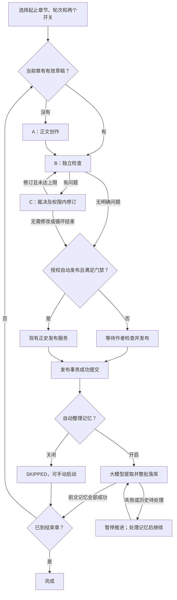

# 章节推进与自动发布

更新：2026-10-14。入口：项目“任务”中的“章节推进”。

## 流程

每章直接复用 DraftLoopService，不重复实现 A/B/C，不恢复合同阶段。已有有效草稿从 B 开始；已作者确认的草稿等待发布，不擅自重写。导入 OCCURRED 章节不自动改写。

## 独立开关

| 设置 | 默认 | 行为 |
| --- | --- | --- |
| autoPublish 自动发布 | 关闭 | 关闭时每章等作者发布；开启时仅在可发布结束条件及来源校验满足后提交正史 |
| autoMemory 自动整理记忆 | 开启 | 发布后排队整理；关闭时不调用整理模型，章节页可手动“开始整理记忆” |

配置随任务存库，刷新恢复，运行中不变更。自动发布不隐含开启记忆整理。手动发布该任务当前章也继承记忆设置，发布请求显式 organizeMemory 可覆盖。

自动发布仅允许 B_CLEAR，或 C_NO_CHANGE 且全部建议判为 REJECT。DEFER、资料不足、轮次耗尽后的未复检稿、无进展、循环、来源变化及失败均不自动发布。门禁不是文学质量保证；勾选是对本次范围的明确发布授权，模型不能直接写正史。

开启记忆时，下一章冻结前要求本章及更早有效发布的记忆全部SUCCEEDED，不能把模型处理结束当作落库成功。PENDING/RUNNING等待，FAILED、NEEDS_CONFIRMATION及缺失任务阻塞；失败不自动付费重试，不撤销正文。新创作请求模型前再次核对；人工修改或重新整理旧章记忆后，已有后文依赖需处理，不能默认沿用旧正文继续。关闭时明确记录SKIPPED，不假称已生成记忆索引；其他前文失败或未解决状态仍会被新创作门槛拦住。

## 可靠性

- 范围最多20章；每章1至10轮检查，默认3轮。生成次数上限1至500，默认100；A/B/C分别计数，失败、中断、继续不重置额度，不是账单硬上限。
- 发布提交后通知与30秒对账共用锁内认领；回滚、重复通知和重复发布不重复创建下一章任务。最后一章完成后不生成范围外章节。
- 停止范围任务同时停止子循环；取消、旧执行尝试、正文行版本与依据校验阻止迟到保存及发布。
- 发布后等待可跨重启恢复；执行中被中断的模型任务须显式重试，不自动重复付费调用。
- 模型/协议失败显示具体章节、A/B/C阶段及安全详情，不只显示DRAFT_LOOP_FAILED。原错误码保留，API新增failureDetail，复用waiting_reason持久化，无迁移。
- 重试恢复当前FAILED子任务的失败节点：保留正文与有效B报告，C失败直接续C，轮数和生成额度不清零。仍核对当前父任务attempt、来源指纹、草稿ID/行版本与DRAFT状态；来源改变则停止，不自动从A重写。
- V062 保存轮次、当前子任务、等待状态、开关及父子关联。迁移不自动授权旧任务，也不把旧等待任务加入发布续跑。
- 自动发布复用 CanonPublicationService 的确认、正史提交、Outbox 和记忆队列事务。独立单章 A/B/C 入口依然只保存草稿。

## 验证

替身模型验证循环、门禁、取消和额度；隔离数据库验证真实迁移、回滚、手动/自动发布、等待记忆及重复通知。前端验证默认值、刷新、参数与单尺寸浏览器排版。不调用真实模型，不改已有小说。

2026-10-12：40项后端单元、2条数据库链路、13项前端测试、类型/ESLint及1条单尺寸浏览器流程通过。21:24按作者授权确认无运行任务及有效租约后重启，21:25 V062已加载，健康UP、5173和任务接口200。未重跑已有任务或开启其自动发布。
