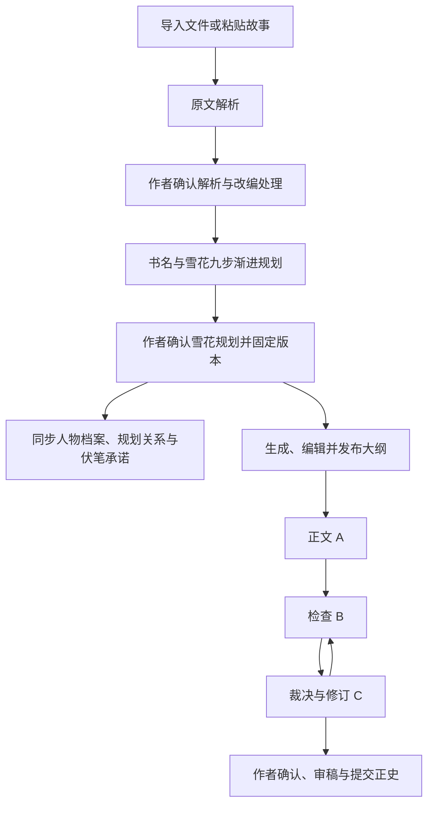

# 已确认雪花规划替代故事方向与独立圣经

2026-10-11。移除独立故事方向、故事圣经页面及生成/选择入口。直接确认雪花运行，不再额外生成方向候选，不保留旧项目兼容或自动回填路径。

## 当前主线



B/C仍遵循原有退出条件与轮次上限；图中循环不意味着无限循环或自动批准正史。

## 资料如何保存

- 第7步在原有一次人物设计请求中同时整理前6步已有规则、秘密、初始关系及伏笔承诺，不新增模型请求或另起故事。模型仍以纯文本保存标题返回；服务端解析后保留自由文本与内部资料投影。
- 第8步继续生成全部场景清单，第9步仍可选。资料投影只整理已有设计；不能借整理新增未经授权的主线或既往事实。
- 确认规划要求最新完整成功的雪花运行、已保存的全部必选步骤和第7步投影。核对冻结的创作边界、策略、导入原文和确认解析；来源变化时拒绝确认。
- 确认后只绑定确切雪花ID及其导入来源，保存不可变规划资料快照并同步资料页面。重复确认当前同一版本不重新建档或同步，保留作者后续修改，不调用模型、不提交正史。
- 新运行的创建与确认使用同一项目行锁，仅短事务内持有，不在模型生成过程中持锁。数据库唯一索引保证每个雪花版本只产生一个直接确认快照。
- 若要换核心主线、人物或结局，应重新进行雪花规划。创作意图编辑移动到项目设置，导入的本次要求、目标字数及边界选择保留；风格试写保留在大纲页。
- 大纲读取确切确认版本；正文使用本章计划、相关人物、规则、前文事实和检索片段，不默认发送整份九步底稿。

## 接口和内部命名

### 资料不可用与无效步骤恢复（2026-10-11）

- 模型明确报告本轮资料不可读取时，返回 `MODEL_INPUT_UNAVAILABLE`（HTTP 502），任务保存为 `FAILED / INPUT_UNAVAILABLE`。完整原始响应保留，不将失败说明保存为成功步骤，也不执行下一步。缺少保存标题另按输出校验失败处理；不改变纯文本返回协议。
- 运行响应增加只读 `invalidSteps`：标记旧读取失败说明及其已保存后续依赖。页面将这些步骤显示为“需重新生成”，不再显示成功，不允许确认无效底稿。读取页面不修改数据库。
- 作者点击继续时核对冻结来源、世界边界与策略，并以原步骤快照CAS保留有效前缀、移除无效后缀及对应资料投影。原始模型响应与作者设置保持，不清空有效步骤、不自动更换会话。成功运行中发现无效内容须重新规划，不直接覆盖确认版本。
- 后端重启不会自动重跑失败任务。向量/Neo4j召回仍走已有服务端流程，本轮先修复完整资料读取，不新增自主检索Agent。

### 代码职责

```text
ImportedStoryBlueprintService       导入规划编排、创作意图收尾
  -> ImportedPlanningSources        权限/确认读取及冻结来源复核（确认规划共用）
  -> ImportedPlanningStore          短 SQL 写入：认领、准备完成、失败/停止
  -> SnowflakePlanningService       九步串行编排、逐步保存和断点恢复
       -> SnowflakeStageGenerator   原样组装单步 Prompt，生成文本及第7步资料投影
       -> SnowflakePlanStore        雪花运行和步骤持久化
```

来源复核保留原文、章节数量、截断标记及确认解析快照比较，JSONB 的数值节点类型差异不误判为内容变化。存储类不代替业务层权限检查；生成器不写状态、不改变执行顺序或追加模型请求。创作意图保留作者已有内容，只在缺失时建立或目标字数改变时更新。记录失败状态也报错时保留原始生成异常与附属错误。

本次只调整类职责，没有迁移、前端接口、提示词版本或输出协议变化。

验证：50项定向测试通过，覆盖架构依赖、九步顺序与断点恢复、共享来源复核、创作意图保留、重复认领拒绝与错误保留；其中2项隔离数据库测试验证完整导入/确认/资料同步/大纲链路。未运行全量测试或真实模型调用。

### 接口与存储

- 新增只读 `GET /api/v1/projects/{projectId}/planning-snapshot`；没有确认规划时204。响应附`sourceSnowflakeId`。
- `POST /api/v1/projects/{projectId}/snowflake-plans/{planId}/actions/confirm`直接确认指定运行，返回带来源ID的资料快照。
- 导入启动与恢复改为`imports/{importId}/actions/prepare-snowflake`、`resume-snowflake`，返回雪花运行而非方向集合；成功状态`PLAN_READY`只表示候选规划准备好，不自动确认。停止后继续复用已保存步骤，完成运行但收尾失败时仅重试确定性收尾。
- 独立`story-directions`控制器、方向工作流、供应商方向生成器、解析器及默认模板已删除。前端不再请求方向接口；提示词活动目录为18种工作流/19份模板。历史全局配置和版本记录未删除。
- 独立`story-bibles`控制器已移除，前端不再请求其生成、编辑、发布或人物补全接口。
- V059增加`snowflake_planning_run.prepared_materials`与资料快照的`source_snowflake_id`及唯一索引。
- V060增加直接确认的`project_id/source_snowflake_id`唯一索引，不回填或改写项目内容。
- 内部暂复用`StoryBibleContent/StoryBibleVersion`和`story_bible_version`作为资料快照存储，减少对正文、检索和同步契约的无关改动。内部命名不表示仍有独立圣经创作阶段。旧圣经服务、生成器、解析器、导入反推圣经链路及人物补全链路已删除；风格推荐通过`ConfirmedSnowflakeService.version`按项目和确切版本只读获取资料。第7步人物设计及其资料投影结构仍保留。
- 未确认的雪花运行不进入权威资料或写作检索；规划人物秘密与未来兑现仍不等于角色已知信息或正史。

## 存量清空

用户明确授权删除全部旧小说项目。`scripts/ResetNovelProjects.java`为显式维护工具，默认只预览；传入`DELETE_ALL_NOVEL_PROJECTS`才删除。

范围：本应用数据库空间内的项目记录、导入、解析、雪花、方向、大纲、正文、任务、资料、正史、向量与会话引用，以及这些表的外键依赖、Outbox和投影检查点。保留用户账号、全局模型配置、提示词及其历史、写作风格预设、OAuth登录凭据和迁移记录；不删除共享数据库或Codex账号历史。

执行前停服且检查运行任务/租约；PostgreSQL显式表清单以RESTRICT清空，不跨schema级联。图谱只清理由被删除项目ID标记的节点。两种数据库不共享事务，图谱失败须明确报告并按捕获ID重试，不能将部分清空报为完成。旧Kafka消息在发现项目已不存在时跳过，不重建已删图谱/向量。

项目私有Codex资料缓存仅在确认路径处于工作区的`tmp/codex-runtime`下且目录名为被删除项目UUID时删除，不触碰账号凭据或全局Codex历史。

## 验证与启用

2026-10-11退休代码清理：删除37个冗余文件，保留活动资料存储及输出投影。后端61项定向测试（含隔离数据库2项链路验证）、前端22项定向测试、类型检查及diff检查通过；未运行全量测试或真实模型评测。检查无运行任务及有效租约后重启，健康UP、前端5173及接口代理200；活动提示词19份，现有两个项目及全局配置保留，不重跑任务。

故事方向退休改造：后端29项定向测试、前端41项定向测试通过；相关文件ESLint和类型检查通过。单组浏览器4项验证覆盖六项导航、刷新状态、确切规划确认后进入大纲、没有方向请求及窄屏入口。隔离数据库2项接口链测试通过，覆盖停止与继续、确认后同步人物/规划关系/台账、重复确认不新增调用、直接生成大纲及旧方向接口404；临时测试schema已清理。未运行全量测试或真实创作模型评测。

2026-10-11 20:12检查无当前运行任务及有效会话租约后重启后端，V060已应用，健康UP。前端5173及API代理200；活动目录18种工作流/19份模板且无故事方向模板；现有未确认项目的planning-snapshot与snowflake-plans/latest返回204，旧story-directions返回404。本轮保留项目和全局配置，不自动确认规划、不重跑任务、不切换模型入口。

以下为前一轮圣经退休/旧项目清空记录，不表示本轮再次清空项目：

2026-10-11 17:13检查无当前运行任务/租约后停服：删除21个旧项目、其关联业务记录和266个项目图谱节点，删除15个UUID命名的项目私有缓存目录；全局配置表行数逐一核对未改变。未删除应用日志、OAuth凭据或Codex账号的原生历史。

17:14前一版启动成功，V059已应用。后端8081健康UP；前端5173与API代理200；项目列表返回`[]`；活动提示词20份且无独立圣经模板。当时导航仍保留故事方向，本轮进一步移除。
